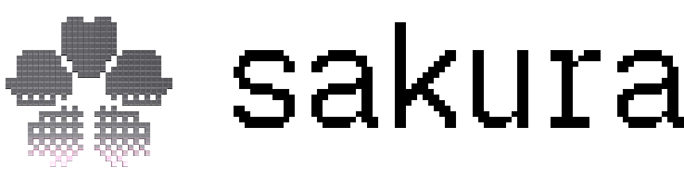

A desktop app for running several coding agents at once and deciding only what needs you.

<p align="center">
  <picture>
    <source media="(prefers-color-scheme: dark)" srcset="docs/images/lockup-app-on-dark.svg">
    
  </picture>
</p>

You tell the Master what you want, or start a lane yourself. A lane is one piece of work in one project: the
engine plans it, builds it in a git worktree, has a reviewer read it, runs your project's checks and delivers a
draft pull request. Whatever needs a decision from you, such as an approval, a question or a stuck lane, shows up
in the Inbox with the context next to it.

Sakura runs on your machine. It has no account, no remote server and no telemetry.

<p align="center">
  
</p>

## What you need

| For | You need |
|-|-|
| The app | macOS 12 or later |
| The engine | `git`, `gh` signed in (for pull requests), Python 3.11 or later, and Claude Code or Codex signed in |
| Lanes you can attach to | `tmux` (optional: without it lanes run headless) |
| A Claude Master | Node.js and the Claude Code ACP adapter, `claude-agent-acp` |
| A Codex Master | `codex` |
| Usage and pace | [Leeway](https://github.com/YarinCardillo/leeway): the signed Mac release carries its helper, otherwise install the Leeway app |

## Install

**macOS 12 or later.** Download `Sakura-<version>.zip` from
[Releases](https://github.com/YarinCardillo/sakura/releases/latest), unzip it and move Sakura to
Applications. Or with Homebrew:

```sh
brew install --cask yarincardillo/tap/sakura
```

The signed Mac release carries the Leeway helper that reads each account's limits, so you do not need the Leeway
app. If Leeway.app is installed too, the engine uses whichever of the two is newer. A bundle built without a helper,
such as the unsigned zip that CI builds, finds Leeway on its own or reports that usage is unavailable.

**The engine.** The app does not carry the engine. It is the `sakura` command in `engine/` of this repository:
clone the repository and put `engine/bin` on your `PATH`, or choose the command in Settings, General. The
variable `SAKURA_BIN` comes before both. Sakura refuses an engine that another account owns or that others can
write.

**The Master's programs.** An app opened from Finder has no shell environment, so name the programs in
`<engine home>/programs.toml`. [engine/docs/master.md](engine/docs/master.md) lists the keys and says where the
engine looks when one is missing.

**Linux (x86_64).** Download `sakura-<version>-linux-x86_64.tar.gz`, unpack it anywhere and run `./sakura` from
the folder. It needs X11 or Wayland and a Vulkan driver. For a desktop launcher, run these commands from the
unpacked folder and keep the folder in place:

```sh
mkdir -p "$HOME/.local/bin" "$HOME/.local/share/applications" "$HOME/.local/share/icons"
ln -sfn "$PWD/sakura" "$HOME/.local/bin/sakura"
cp -R share/icons/hicolor "$HOME/.local/share/icons/"
sed "s|^Exec=sakura$|Exec=\"$PWD/sakura\"|" sakura.desktop > "$HOME/.local/share/applications/sakura.desktop"
```

Linux has no Leeway, and the engine's always-on services (the keeper, the phone page and scheduled automations)
use macOS LaunchAgents. There you get the window and the lanes, without usage, Pace or those services.

**Windows.** Not supported in 0.4.0. The engine is a Unix program and the window has no way to start it on
Windows. The archive `Sakura-<version>-windows-x86_64.zip` is built by CI and compiled, nothing more.

## First use

1. Open Sakura. If the window says the engine was not found, set its path in Settings, General.
2. Add a project: open Settings (Cmd-,), choose **Projects**, press **Add project** and pick the folder of a git
   repository. A repository inside a folder that an agent can write, such as a temporary folder, is refused.
3. Start a lane with Cmd-N or the plus beside Projects in the sidebar: pick the project, give the lane a title, say
   what it should do, choose a Preset and a Pace, and press **Start**. Or open **Master**, choose a project and ask for
   the work in words. The Master opens the lanes and shows each one as a card in the conversation.
4. Open the **Inbox**. When a lane needs you, the ask is there with its lane, project and the steps done so far.
   Press **Approve**, **Decline** or **Reply**. A decision waits six seconds with an **Undo** before it is sent.
5. When the lane finishes, its page shows the report, and **Deliver** appears in the Inbox as one more ask. Sakura
   never merges a pull request and never marks one ready: it leaves a draft for you.

## The pages

**Inbox** opens first. Asks are grouped by lane. Each shows its kind in words (Approval, Question, Stuck, Check,
Knowledge, Automation), what it asks and where it came from. J and K move, A approves, D declines, R replies and
Return opens the lane. A stuck lane offers **Resume** and **Stop**. The **Done** view lists the asks you decided,
with the answer you gave. The morning digest is a group in the Inbox.

**Master** is a conversation with one agent that opens lanes, steers them and tells you what happened. It never
edits a project. A switch in the header chooses Claude or Codex, and the choice is remembered per project. Attach files
with the button, by drag and drop or by paste. **Start fresh** keeps the old conversation under **History**. The
conversation comes back after a restart.

**Lanes** lists every lane by state: Needs you, Running, Finished, Stopped. A row shows the title, the project, the
step and its progress, and the Preset. A lane that an agent outside the engine opened is marked Outside.

**A lane's page** keeps the lane's name, its state and its steps (Plan, Build, Checks, Deliver) at the top, and only
the conversation scrolls. It shows what the agents did and said, named by role. **Write to the lane** sends a message
to the agent at work. The column on the right has **Details** (project, branch, Preset, Pace, agents and models, the
lane's open asks), **Changes** (every changed file with its diff) and **Files** (the file the agent is on, with Follow
agent). Cmd-Opt-B hides the column.

**Engine** draws how a lane runs: Start, Plan, Build, Checks and Deliver, with the reviews that loop on them and the
guard under every step. Click a step to change its rules, and save the result as a new Preset. Below it are Pace,
the running lanes, and **In the background**: the keeper, the phone page and **Automations**, each with its switch.

**Settings** (Cmd-,) opens inside the window: General, Projects, Accounts, Connectors, Notifications, Shortcuts,
Updates and About.

Other keys: Cmd-K opens the command palette, which goes to any lane, project or page and runs any action of the page
in view. Cmd-P opens a file of the lane in view. Cmd-T opens a tab, Cmd-W closes it, Cmd-1 to Cmd-9 switch tabs, Cmd-[
and Cmd-] go back and forward, and Cmd-B hides the sidebar. Cmd-click on a lane in Lanes opens it in a new tab.

## Presets

A Preset is the shape of a lane: its steps, which reviews run, how many agents work at once and on which models.
Build and Deliver are always on.

| Preset | What a lane does |
|-|-|
| Solo | One agent builds from the goal. No plan, no reviews, no checks step |
| Lean | Plan, Build, one review of the whole branch, Deliver. No plan review, no step reviews, no checks step |
| Standard | Plan, a plan review, Build with a review of each step, Checks, Deliver |
| Verified | Standard, and an evaluator that proves each row of the lane's contract with evidence |

Change a rule on the Engine page and save it under a name to keep your own Preset. A running lane can switch Preset
from its Details, for example to Lean in a hurry: the change applies from the lane's next step. The number of lanes
has a minimum and a maximum, and Pace moves the running lanes between them.

## Pace and accounts

Sakura never assumes one Claude and one Codex. It reads your accounts, each with its provider, its name and its
weekly reset, from [Leeway](https://github.com/YarinCardillo/leeway), which finds the default `~/.claude` and
`~/.codex` folders and managed Claude profiles. Add other folders in Leeway. Settings, Accounts lists them and
renames them. With one account, no account choice appears anywhere.

Pace is the percentage of its week an account should land on at its reset. Before every step the engine asks Leeway
where the step's account is forecast to land. Above the line, the lane waits.

| Pace | Line at the reset |
|-|-|
| Slowest | 50% |
| Slow | 70% |
| Normal | 90% |
| Fast | 100% |
| Fastest | No line |

A lane has its own Pace, Slow, Normal or Fast. Slow moves its line ten points lower, and Fast has no line. The reserve
and the five-hour limit stay in force at every level, so Fastest never spends an account past its reserve.

Each step of a Preset can run on its own account, and by default it runs on the project's account. When a step's
account is over the line and the Preset leaves the account to the project, the engine moves the step to another
account of the same provider, but only to one you allowed for that project. With none allowed, it waits. The
allowed list has no control in the window yet: set it with `sakura engine pace-accounts`, which
[engine/docs/cockpit-api.md](engine/docs/cockpit-api.md) describes.

**Give priority to my sessions** on the Engine page makes lanes wait while you work with an agent yourself, and
start again when you stop.

## The security model

- The window runs one program, the engine's `sakura` command, plus the Master's own agent program. Every change
  you make, such as an approval, a stop or a new lane, is one engine command from a fixed table, written to an
  action log with who asked. Approve, stop and close ask first.
- Lanes run on your Mac, as you, inside the native sandbox of Claude Code or Codex that the engine configures for
  every run. A lane writes only in its own worktree, its repository's git folder and a temporary folder. It cannot read
  folders that hold secrets. Its network is an allow-list. Programs that reach outside the sandbox
  (`osascript`, `open`, `launchctl`, `docker`, `security`, `git push`) are denied. Anything that would ask you
  goes to the engine instead, which answers from a policy and records each refusal.
- The engine's state lives outside every repository, because a lane and its `.git` can be written by agents.
  Repository hook commands never run unless you trust the file with `sakura trust`.
- What an agent, a repository or an outside session writes is data, never an instruction to the Master. The Master
  cannot edit a project, approve, mark, accept, resume or change configuration. Those stay yours.
- The phone page shows the Inbox and the lanes on your own private network. A device gets in only when its login
  and its node are listed in `~/.config/sakura/cockpit.toml`, and every request passes one gate
  ([engine/docs/cockpit-api.md](engine/docs/cockpit-api.md)). From a phone you can read, approve, decline, reply, stop,
  resume, clean up and write to a lane. You cannot start a lane, add a project, change Presets, Pace or accounts,
  turn services or automations on, or accept an automation. Those only work in the window or on the command line
  of the Mac itself.
- Sakura does not read your passwords. Connectors keep their secrets in your Keychain, and the engine reads one at the
  moment it uses it. The Leeway helper reads usage with one minimal `claude` request per reading and never reads
  credentials.
- Besides the update check and the connectors you add, Sakura makes no network calls of its own. Agents use the
  network under their own tool's rules.
- A lane is not a box. Containers were the 0.1 design. The service that confined agents in Docker is still in this
  repository ([service/README.md](service/README.md)) and builds with `--features boxes`, but 0.4.0 does not use it.

A lane runs with your user's permissions, so start one only with code and agents you trust. Report a vulnerability
as [SECURITY.md](SECURITY.md) says.

## Where things are

Paths on macOS:

| What | Where |
|-|-|
| The engine home: configuration, lanes, presets, rules | `~/Library/Application Support/Sakura/engine` |
| The engine's logs, action log and usage archive | `~/.local/state/sakura` |
| Your own engine configuration | `~/.config/sakura` |
| Leeway's accounts and history | `~/Library/Application Support/leeway` |

| Variable | Meaning |
|-|-|
| `SAKURA_BIN` | The engine's `sakura` command, in place of Settings or `PATH` |
| `SAKURA_ENGINE_HOME` | The engine home, in place of the default; an existing folder you own with mode 0700 |
| `SAKURA_ACP_ADAPTER` | The Claude Master's adapter, when `programs.toml` does not name one |
| `SAKURA_CODEX` | The `codex` command for the Codex Master |
| `SAKURA_LEEWAY` | The Leeway helper; the Mac app sets it to the one it carries |
| `SAKURA_APPEARANCE` | `dark` or `light`, in place of the system's |
| `SAKURA_LANGUAGE` | `en` or `it` for one launch, in place of the system's or the one chosen in Settings |
| `SAKURA_NO_ACTIVATE` | Do not bring the app to the front at launch |

## Uninstall

Move Sakura to the Trash, or run `brew uninstall --cask sakura`. Your lanes, their worktrees and the engine home stay
where they are until you delete them. `sakura keeper uninstall` removes the keeper's LaunchAgent and leaves every lane
as it is.

## Building from source

Rust 1.99. On Linux also the development packages listed in
[.github/workflows/ci.yml](.github/workflows/ci.yml).

```sh
cargo run --release -p sakura-app
SAKURA_BIN="$PWD/engine/bin/sakura" cargo run --release -p sakura-app   # with the engine of this checkout

cargo fmt --all --check
cargo clippy --workspace --all-targets -- -D warnings
cargo test --workspace -- --test-threads=1
python3 -m pytest -q engine/tests                  # the engine's suite (Python 3.12 or later)
python3 -m unittest discover -s scripts/tests      # the release scripts

SAKURA_LEEWAY_HELPER=/path/to/leeway scripts/bundle-macos.sh   # Sakura.app with the helper, signed ad hoc
```

`crates/sakura-core` holds the model and talks to the engine, `crates/sakura-acp` is the Master's conversation over
the Agent Client Protocol, `crates/sakura-terminal` is a terminal view used by the `boxes` build, and
`crates/sakura-app` is the window. `engine/` is the `sakura` command, the workflow engine (Python, standard library
only). `service/` is the `box` command of the earlier design. Without `SAKURA_LEEWAY_HELPER`, the bundle has no
helper and the engine looks for Leeway on its own.

## What is verified on each system

CI formats, lints and tests the app on macOS, Linux and Windows, runs the service's suite on Linux and macOS, and
checks the service's confinement against a real Docker on Linux. CI does not run the engine's tests and never opens
the app: the engine's suite runs by hand, and 0.4.0 is made and used on macOS. The Linux and Windows archives are built
and nothing more. Hosted results are in [Actions](https://github.com/YarinCardillo/sakura/actions).

## Licence

Sakura is AGPL-3.0-only and contains GPL-3.0-or-later code adapted from Zed, combined under section 13 of both
licences. See [LICENSE](LICENSE). What Sakura is built from is listed in [THIRD_PARTY_NOTICES](THIRD_PARTY_NOTICES).
Packaged builds also carry the original dependency copyright and licence texts in `THIRD_PARTY_LICENSES`.
[Changelog](CHANGELOG.md), [security](SECURITY.md), [contributing](CONTRIBUTING.md), [releasing](docs/release.md).
